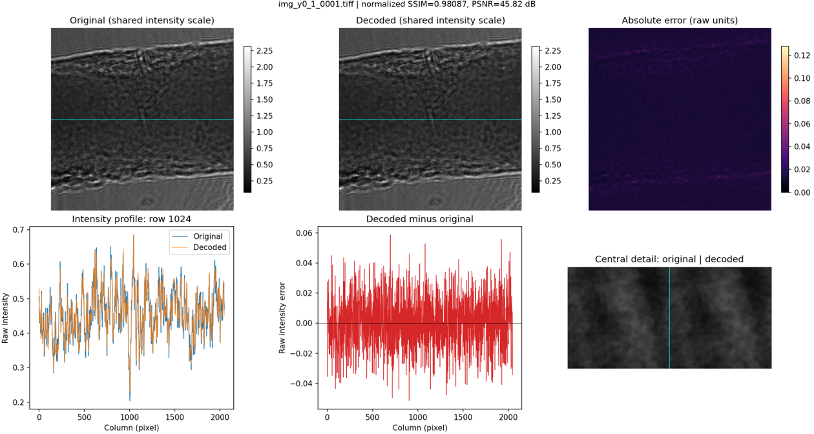

# HoloZip

**Learned lossy compression for X-ray holograms using a 2-D Haar wavelet transform and an entropy hyperprior.**

Developed by **Vahid Rahmani**, DESY FS-PETRA. HoloZip provides training,
archive compression/decompression, and measured quality evaluation through a
Python package and command-line interface.

## Measured example

On 2206 evenly spaced 2048 × 2048 float32 frames from one Mg hologram dataset:

| Metric | Result |
| --- | ---: |
| Original TIFF files | 35.296 GB |
| Encoded archive, including metadata | 386.21 MB |
| Compression ratio, excluding checkpoint | **91.33×** |
| Mean normalized SSIM | **0.98087** |
| Mean normalized PSNR | **45.49 dB** |
| Mean raw-domain PSNR | 45.82 dB |
| Encode / decode throughput in this run | 1.19 / 1.21 frames/s |

Measured on an NVIDIA RTX A6000 with two PyTorch CPU threads. Sizes use decimal
MB. SSIM is single-scale Gaussian-window SSIM. Quality metrics are arithmetic
per-frame averages; normalized and raw domains are distinct. The short timing
run includes cold-start effects and excludes setup, metrics and plotting as
detailed in the [benchmark documentation](docs/benchmark.md).

This is a **within-dataset evaluation**, not a held-out generalization study.
Training overlap has not been ruled out. See the [CSV and full run metadata](benchmarks/results/mg_12_frames/).
These figures describe this 2-D codec and are separate from earlier HoloZip variants.

## Visual example



The illustration is source frame 1 from the separate three-frame comparison
run (normalized SSIM 0.96087, PSNR 42.47 dB). Original and decoded panels share
an intensity scale. The residual map shows absolute raw-intensity error.
A single image comparison does not validate downstream phase retrieval.

## Installation

Python 3.11 is recommended for the tested GPU environment; Python 3.12 was
used for local CPU checks. Install an appropriate PyTorch/torchvision pair for
your CPU or CUDA setup, then install the package in a virtual environment:

```bash
python -m venv .venv
source .venv/bin/activate
python -m pip install --upgrade pip
python -m pip install -e ".[dev]"
python -m holozip --help
```

For the exact local CPU package versions, see `requirements-tested-cpu.txt`.
For an existing environment where the original script already runs, use
`python -m pip install -e . --no-deps` to preserve its dependencies. Install
pytest separately if needed. Windows activation is `.venv\Scripts\activate`.

## Train, compress and decompress

```bash
python -m holozip compute-stats --data-dir DATA --output runs/stats.json
python -m holozip precompute-sampling-pool --data-dir DATA --stats runs/stats.json --output runs/pool.npz
python -m holozip train --data-dir DATA --stats runs/stats.json --sampling-pool runs/pool.npz --checkpoint runs/model.pth
python -m holozip compress-dataset --data-dir DATA --stats runs/stats.json --checkpoint runs/model.pth --archive runs/data.hiwh
python -m holozip reconstruct --checkpoint runs/model.pth --archive runs/data.hiwh --output-dir runs/decoded
```

`DATA` is a directory of compatible TIFF images. Default matching is `*.tiff`,
with `*.tif` fallback. Start with the default 256-pixel crop and tile size.
`reconstruct` means hologram decompression, not phase retrieval. The exact
matching checkpoint is required for decoding. Configuration defaults are in
`configs/default.json`; the CLI exposes the original argument subset rather
than loading that JSON directly. Read [known constraints](docs/limitations.md)
before selecting new image sizes or evaluating generalization.

A small software fixture can be generated with:

```bash
python examples/make_demo_data.py --output runs/demo
```

For a smoke-training run on those four images, use the workflow above with
`--data-dir runs/demo` and training options
`--epochs 1 --batch-size 1 --num-workers 0 --val-batches 1`.
This fixture is not a physical hologram simulator.

## Real hologram examples

Three original **2048 × 2048 float32 TIFFs** with shared normalization statistics
are included in [examples/real_holograms](examples/real_holograms/). Pixel values
and original TIFF bytes are preserved. These are execution examples, not an
independently held-out dataset.

The matching pretrained checkpoint is included at
`checkpoints/hiwh_v2_100e_best.pt`, allowing the examples to run without retraining.


```bash
OMP_NUM_THREADS=2 MKL_NUM_THREADS=2 OPENBLAS_NUM_THREADS=2 \
python -m holozip benchmark --data-dir examples/real_holograms --checkpoint checkpoints/hiwh_v2_100e_best.pt --stats examples/real_holograms/global_stats.json --count 3 --output-dir runs/real_examples --cpu-entropy-threads 0 --save-decoded
```

See the [example guide](examples/real_holograms/README.md) for checkpoint
requirements, file checksums and expected outputs.

## Benchmark and compare

```bash
python -m holozip benchmark --data-dir DATA --checkpoint MODEL.pt --stats global_stats.json --count 12 --output-dir runs/benchmark12
python -m holozip compare --data-dir DATA --checkpoint MODEL.pt --archive runs/benchmark12/selected.hiwh --output-dir runs/comparison
```

The benchmark selects evenly spaced source indices, writes an actual archive,
decodes it and exports `metrics.csv`, `summary.json`, comparison PNGs and
numeric line-profile CSVs. Use `--indices 0 200 400` for explicit source indices,
`--profile-row` for a different horizontal profile and `--save-decoded` for TIFF
exports. Output directories must be new or empty.

On older native thread runtimes, configure threads before startup and preserve
that setting in evaluation commands:

```bash
OMP_NUM_THREADS=2 MKL_NUM_THREADS=2 OPENBLAS_NUM_THREADS=2 \
python -m holozip benchmark --data-dir DATA --checkpoint MODEL.pt --stats global_stats.json --count 12 --output-dir runs/benchmark12 --cpu-entropy-threads 0
```

See [benchmark definitions](docs/benchmark.md) and [checkpoint availability](checkpoints/README.md).

## Tests

```bash
OMP_NUM_THREADS=2 MKL_NUM_THREADS=2 OPENBLAS_NUM_THREADS=2 python -m pytest -q
python -m ruff check src tests
```

The test suite covers Haar inversion, normalization, tiling, archive records,
loss/optimizer updates, checkpoint loading, actual entropy coding, original-code
regression comparisons, benchmark accounting, visual export and thread setup.
The project author reported the earlier 46 tests passing on Python 3.11/CUDA. Local CPU
results and the recorded target environment are in [validation](docs/validation.md).
CI configuration is included; no hosted CI pass is claimed before it runs.

## Project layout

| Path | Responsibility |
| --- | --- |
| `src/holozip/models/` | Haar transform and neural hyperprior model |
| `src/holozip/data/` | TIFF discovery, shared normalization and soft sampling |
| `src/holozip/training/` | Losses, training loop and checkpoints |
| `src/holozip/codec/` | Tiling, entropy coding and archive records |
| `src/holozip/evaluation/` | Benchmarks, metrics reports and plots |
| `tests/` | Regression and integration tests |
| `benchmarks/results/` | Measured example results |
| `provenance/` | Original source and extraction mapping for regression tests |

See [architecture](docs/architecture.md) and [archive format](docs/archive_format.md).

## license

This project is licensed under the MIT License.
See [LICENSE](LICENSE) for details.
